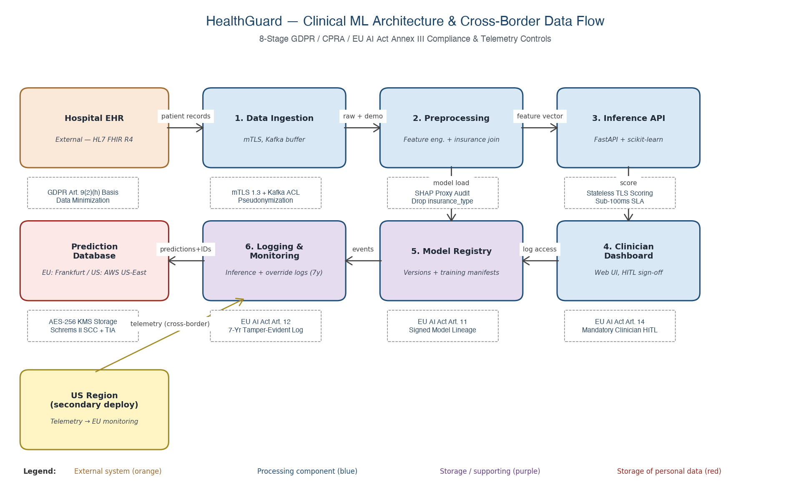

# HealthGuard AI GRC: Clinical ML Fairness Audit, TreeSHAP Attribution & EU AI Act Portfolio

End-to-end AI Security Governance, Risk, and Compliance (GRC) technical audit and regulatory deliverable suite for **HealthGuard**, a clinical Type-2 diabetes triage classifier (`N = 3,000` held-out patient records)—combining **intersectional subgroup fairness auditing**, **TreeSHAP socioeconomic proxy attribution**, **counterfactual model retraining**, **Key Risk Indicator (KRI) thresholds**, **MITRE ATLAS adversarial ML threat modeling**, **GDPR/CPRA Schrems II transfer impact assessment**, and **EU AI Act Annex III high-risk conformity**.



---

## Headline Technical Audit & De-Biasing Findings

| Metric / Subgroup (`N = 3,000`, Threshold `0.26`) | Baseline Model (`with insurance_type`) | Counterfactual Retrained (`no insurance_type`) | Impact |
| :--- | :---: | :---: | :--- |
| **Overall Discrimination (`ROC-AUC`)** | `0.812` | **`0.807`** | `-0.005` (clinical utility preserved) |
| **`('Rural', 'Medicaid')` False Negative Rate** | `60.6%` *(missed >3 in 5 sick patients)* | **`48.5%`** | **`-12.1 pp` missed-triage reduction** |
| **Within-Rural Medicaid vs. Private FNR Gap** | `+37.5 pp` (`60.6%` vs `23.1%`) | **`+6.2 pp`** (`48.5%` vs `42.3%`) | **`-31.4 pp` proxy bias elimination** |
| **Max Intersectional Subgroup FNR Span (`KRI-1`)** | `43.4 pp` (`RED` breach `> 15 pp`) | `31.6 pp` (structural `geographic_region` isolated) | Requires regional threshold calibration |
| **Automated Test Suite (`pytest lab/tests/`)** | **`34 / 34` passing (`100%`)** | — | Verified in [`test_results.log`](test_results.log) |

- **Mechanistic SHAP Proof (`lab/shap_analysis.py`, `audit_notebook.ipynb`)**: Global `mean(|SHAP|)` ranked `insurance_type` (`0.1235`) and `geographic_region` (`0.1194`) immediately behind `HbA1c` (`0.6194`), while local TreeSHAP decomposition on missed rural Medicaid patients proved `insurance_type=Medicaid` (`-0.234`) + `geographic_region=Rural` (`-0.271`) jointly suppressed log-odds by `-0.505` below the `0.26` clinical triage threshold despite an elevated `8.2%` HbA1c.

---

## 8-Deliverable Regulatory Portfolio ([`governance_portfolio.xlsx`](governance_portfolio.xlsx))

1. **D1 — Regulatory Applicability**: EU AI Act Art. 6(2) / Annex III §5(a) High-Risk classification, US FDA SaMD assessment, NIST AI RMF 1.0 & ISO/IEC 42001 mapping.
2. **D2 — Privacy & Cross-Border Data Governance**: 8-stage GDPR Art. 9(2)(h) / CPRA data flow obligations + 6-step Schrems II Transfer Impact Assessment (EU Frankfurt → US-East telemetry).
3. **D3 — MITRE ATLAS Threat Model**: 4 concrete clinical ML attack vectors (`AML.T0048` clinician override feedback poisoning, `AML.T0020` supply-chain pickle tampering, `AML.T0024` model inversion, `AML.T0043` boundary evasion).
4. **D4 — NIST AI RMF Risk Register**: 12 scored technical, socio-technical, legal, and adversarial risks with residual mitigation owners.
5. **D5 — Intersectional Fairness & TreeSHAP Audit**: Full subgroup confusion metrics, disparate impact ratios, and counterfactual ablation results.
6. **D6 — Transparency Model Card**: Intended clinical use, out-of-scope guardrails, subgroup limitations, and clinician HITL override protocol.
7. **D7 — Operational Key Risk Indicators (`lab/kri.py`)**: Quantitative Green / Amber / Red operational bands (`KRI-1` Intersectional FNR Gap, `KRI-2` Override Drift, `KRI-3` Feature PSI).
8. **D8 — EU AI Act Art. 73 Incident Playbook**: 15-day / 2-day serious-incident regulatory escalation and model rollback runbook.

---

## Quick Start

```bash
python3 -m venv .venv
source .venv/bin/activate
pip install -r requirements.txt

# Run all 34 fairness, intersectional audit, TreeSHAP, and KRI unit tests
pytest lab/tests/ -v
```

## License

MIT License — see [LICENSE](LICENSE).
