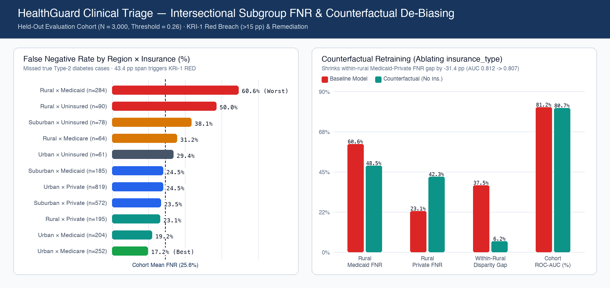
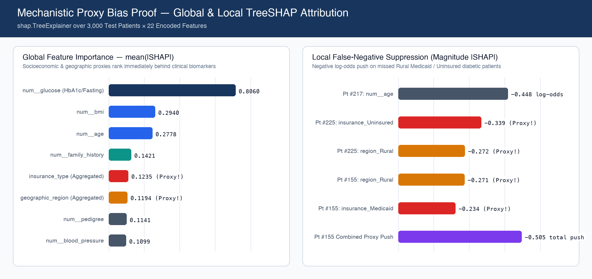

<div align="center">
  
  <br/><br/>
  [](https://github.com/kenseiAmit/clinical-ai-governance-fairness-audit/actions/workflows/ci.yml)
  
  
  
  
  

  <br/>
  
</div>

---

End-to-end AI Security Governance, Risk, and Compliance (GRC) technical audit and 8-deliverable regulatory portfolio for **HealthGuard**, a clinical Type-2 diabetes triage classifier (`N = 3,000` held-out patients, operating threshold `0.26`). Combines **12-cell intersectional subgroup fairness auditing**, **TreeSHAP socioeconomic proxy proof**, **counterfactual model retraining**, **Key Risk Indicator (KRI) drift bands**, **MITRE ATLAS adversarial ML threat modeling**, **GDPR/CPRA Schrems II transfer impact assessment**, and **EU AI Act Annex III high-risk conformity**.

---

## 1. Intersectional Fairness Audit & Counterfactual De-Biasing (`N = 3,000`)



| Region × Insurance Subgroup | `n_total` | `n_positives` | Selection Rate | Baseline FNR | Baseline FPR | Accuracy | KRI-1 Status |
| :--- | :---: | :---: | :---: | :---: | :---: | :---: | :---: |
| **`Rural × Medicaid`** | `284` | `33` | `0.204` | **`60.6%`** | `17.9%` | `0.771` | **RED (`Worst Cell`)** |
| `Rural × Uninsured` | `90` | `10` | `0.156` | `50.0%` | `11.2%` | `0.844` | Sample `< 20` |
| `Suburban × Uninsured` | `78` | `21` | `0.295` | `38.1%` | `17.5%` | `0.769` | Amber |
| `Rural × Medicare` | `64` | `16` | `0.422` | `31.2%` | `33.3%` | `0.672` | Sample `< 20` |
| `Suburban × Medicaid` | `185` | `49` | `0.416` | `24.5%` | `29.4%` | `0.719` | Nominal |
| `Urban × Private` | `819` | `233` | `0.426` | `24.5%` | `29.5%` | `0.719` | Nominal |
| `Suburban × Private` | `572` | `153` | `0.435` | `23.5%` | `31.5%` | `0.706` | Nominal |
| **`Rural × Private`** | `195` | `52` | `0.369` | **`23.1%`** | `22.4%` | `0.774` | **Within-Rural Ref (`+37.5 pp` gap)** |
| `Urban × Medicaid` | `204` | `52` | `0.397` | `19.2%` | `25.7%` | `0.760` | Nominal |
| **`Urban × Medicare`** | `252` | `64` | `0.437` | **`17.2%`** | `30.3%` | `0.730` | **Best Cell (`43.4 pp` Span)** |

---

## 2. Mechanistic TreeSHAP Socioeconomic Proxy Attribution



- **Counterfactual Retraining Proof (`audit_notebook.ipynb` Cell 20)**: Ablating `insurance_type` preserved overall discrimination (`ROC-AUC = 0.807` vs. `0.812` baseline) while cutting `Rural × Medicaid` FNR from **`60.6%` → `48.5%` (`-12.1 pp`)** and collapsing the within-rural Medicaid–Private disparity gap from **`+37.5 pp` → `+6.2 pp` (`-31.4 pp` reduction)**.

---

## 3. GDPR / CPRA / EU AI Act Cross-Border Data Flow Architecture


---

## 4. Verified Automated Audit Test Suite ([`test_results.log`](test_results.log) — `34/34 Passed`)

```text
============================= test session starts ==============================
platform darwin -- Python 3.12.14, pytest-8.3.5, pluggy-1.7.0 -- /workspace/clinical-ai-governance-fairness-audit Security Engineer/ Course 4 AI Security GOvernance Risk and Complaince/ai-sec-eng-c4-healthguard-grc-project-starter/.venv/bin/python3.12
cachedir: .pytest_cache
rootdir: /workspace/clinical-ai-governance-fairness-audit Security Engineer/ Course 4 AI Security GOvernance Risk and Complaince/ai-sec-eng-c4-healthguard-grc-project-starter/starter
plugins: platformdirs-4.13.4, anyio-4.15.1
collecting ... collected 34 items

lab/tests/test_audit.py::test_subgroup_returns_dataframe_with_expected_columns PASSED [  2%]
lab/tests/test_audit.py::test_subgroup_has_one_row_per_group PASSED      [  5%]
lab/tests/test_audit.py::test_subgroup_intersectional_uses_multiindex PASSED [  8%]
lab/tests/test_audit.py::test_subgroup_metrics_arithmetic_for_one_cell PASSED [ 11%]
lab/tests/test_audit.py::test_find_most_harmed_returns_none_when_filter_excludes_all PASSED [ 14%]
lab/tests/test_audit.py::test_find_most_harmed_returns_correct_group PASSED [ 17%]
lab/tests/test_audit.py::test_find_most_harmed_filters_low_n PASSED      [ 20%]
lab/tests/test_audit.py::test_proxy_supported_when_within_gap_exceeds_reference PASSED [ 23%]
lab/tests/test_audit.py::test_proxy_inconclusive_when_cell_missing PASSED [ 26%]
lab/tests/test_fairness_metrics.py::test_fnr_perfect_recall_is_zero PASSED [ 29%]
lab/tests/test_fairness_metrics.py::test_fnr_no_positives_returns_nan PASSED [ 32%]
lab/tests/test_fairness_metrics.py::test_fnr_basic_arithmetic PASSED     [ 35%]
lab/tests/test_fairness_metrics.py::test_fpr_no_negatives_returns_nan PASSED [ 38%]
lab/tests/test_fairness_metrics.py::test_fpr_basic_arithmetic PASSED     [ 41%]
lab/tests/test_fairness_metrics.py::test_selection_rate_basic PASSED     [ 44%]
lab/tests/test_fairness_metrics.py::test_dpd_finds_max_min_groups PASSED [ 47%]
lab/tests/test_fairness_metrics.py::test_dpd_with_clear_disparity PASSED [ 50%]
lab/tests/test_fairness_metrics.py::test_eod_returns_dict_shape PASSED   [ 52%]
lab/tests/test_fairness_metrics.py::test_eod_picks_larger_of_fnr_or_fpr_diff PASSED [ 55%]
lab/tests/test_kri.py::test_override_green PASSED                        [ 58%]
lab/tests/test_kri.py::test_override_amber_via_rate_band PASSED          [ 61%]
lab/tests/test_kri.py::test_override_amber_via_structured_share_band PASSED [ 64%]
lab/tests/test_kri.py::test_override_red_via_rate_breach PASSED          [ 67%]
lab/tests/test_kri.py::test_override_red_via_structured_share_breach PASSED [ 70%]
lab/tests/test_kri.py::test_anomaly_green_below_one_per_thousand PASSED  [ 73%]
lab/tests/test_kri.py::test_anomaly_amber_in_band PASSED                 [ 76%]
lab/tests/test_kri.py::test_anomaly_red_above_threshold PASSED           [ 79%]
lab/tests/test_kri.py::test_anomaly_zero_inferences_is_insufficient PASSED [ 82%]
lab/tests/test_kri.py::test_fnr_drift_green_when_gap_small PASSED        [ 85%]
lab/tests/test_kri.py::test_fnr_drift_red_when_gap_large PASSED          [ 88%]
lab/tests/test_shap_analysis.py::test_detect_excludes_protected_features PASSED [ 91%]
lab/tests/test_shap_analysis.py::test_detect_returns_top_k PASSED        [ 94%]
lab/tests/test_shap_analysis.py::test_detect_signed_strength_bounds PASSED [ 97%]
lab/tests/test_shap_analysis.py::test_detect_dataframe_columns PASSED    [100%]

=============================== warnings summary ===============================
../.venv/lib/python3.12/site-packages/matplotlib/_fontconfig_pattern.py:64
  /workspace/clinical-ai-governance-fairness-audit Security Engineer/ Course 4 AI Security GOvernance Risk and Complaince/ai-sec-eng-c4-healthguard-grc-project-starter/.venv/lib/python3.12/site-packages/matplotlib/_fontconfig_pattern.py:64: PyparsingDeprecationWarning: 'oneOf' deprecated - use 'one_of'
```

---

## 5. 8-Tab Enterprise Governance Workbook ([`governance_portfolio.xlsx`](governance_portfolio.xlsx))

Covers **D1** EU AI Act Annex III §5(a) / FDA SaMD / NIST AI RMF / ISO 42001 mapping, **D2** GDPR Art. 9(2)(h) + 6-step Schrems II TIA, **D3** MITRE ATLAS (`AML.T0048` clinician override poisoning, `AML.T0020`, `AML.T0024`, `AML.T0043`), **D4** 12-row Risk Register, **D5** Technical Fairness & SHAP Audit, **D6** Model Card, **D7** KRI Thresholds (`lab/kri.py`), and **D8** EU AI Act Art. 73 Incident Playbook.

```bash
python3 -m venv .venv
source .venv/bin/activate
pip install -r requirements.txt
pytest lab/tests/ -v
```

## License

MIT License — see [LICENSE](LICENSE).
